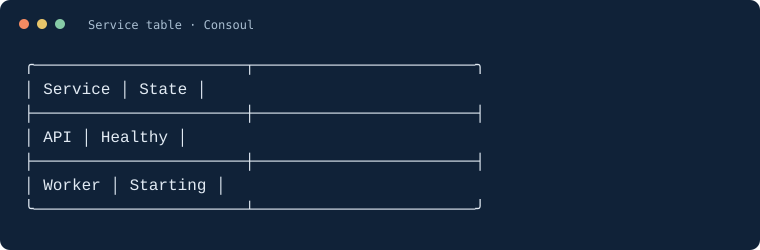
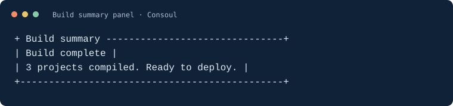
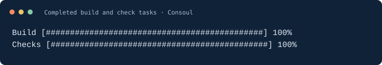
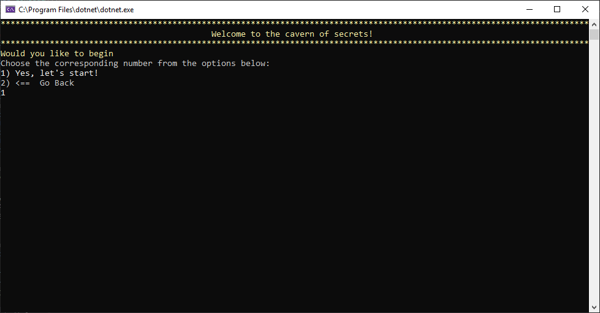

# Examples & screenshots

Each snippet below can replace `Program.cs` in the app from [Getting started](getting-started.md). They use the core package only. Output previews are generated from these snippets using `Consoul.Capture` at a fixed width; they show text and layout without terminal colors or animation.

## Tables

Use a table to compare values at a glance. Markup colors individual cells in an interactive terminal.

```csharp
using ConsoulLibrary;

var table = new Table()
    .RoundedBorder()
    .Width(48)
    .HideFooter()
    .AddColumn("Service")
    .AddColumn("State")
    .AddRow("API", "[green]Healthy[/]")
    .AddRow("Worker", "[yellow]Starting[/]");
AnsiConsole.Write(table);
```



[Table options, model binding, and selection →](tables.md)

## Panels and markup

Frame a short summary with a title. Use markup for developer-authored status text.

```csharp
using ConsoulLibrary;

Consoul.Panel(
    "[green]Build complete[/]\n3 projects compiled. Ready to deploy.",
    title: "Build summary",
    width: 48);
```



When inserting user input into markup, use `MarkupLineInterpolated` so brackets in values remain literal:

```csharp
using ConsoulLibrary;

string project = "demo[1]";
Consoul.MarkupLineInterpolated($"[cyan]Building {project}[/]");
```

[Output, styling, composition, and capture →](core-console.md)

## Task progress

Create a task for each unit of work and update it as work completes. This small demo uses delays to make progress visible; replace them with your application's work.

```csharp
using System.Threading;
using ConsoulLibrary;

Consoul.Progress(progress =>
{
    var build = progress.AddTask("Build", 3);
    var checks = progress.AddTask("Checks", 2);

    for (int i = 0; i < 3; i++)
    {
        Thread.Sleep(150);
        build.Increment(1);
    }
    build.Complete();
    checks.Increment(1);
    Thread.Sleep(150);
    checks.Complete();
});
```



The preview shows the final captured state. In a capable terminal, progress updates in place; redirected output may behave differently.

[Status, spinners, live displays, and progress options →](progress.md)

## Interactive menus

A dynamic view connects menu choices to actions. Run this in a terminal, choose an option by number, and use `back` to leave the menu.

```csharp
using ConsoulLibrary;

Consoul.View("Developer tools")
    .Option("Say hello", () =>
    {
        Consoul.Write("Hello from Consoul!");
        Consoul.Wait();
    })
    .DescribeLastOption("Write a message and return to the menu.")
    .ShortcutLastOption("h")
    .Render();
```

[Model-backed views and navigation →](views.md)

## A console app in practice

This original repository screenshot shows the **Tiny Text Adventures** sample running in a Windows console. It illustrates a menu-driven app; it is a legacy screenshot, not output from the 3.0 snippets above.



## Reproduce the previews

The [documentation sample runner](https://github.com/tbm0115/Consoul/tree/develop/scripts/DocsExamples) compiles the C# snippets from this page, captures their actual rendered output, and writes the SVG previews. From the repository root:

```shell
dotnet run --project scripts/DocsExamples -- docs
```

The SVG files include selectable text and accessible descriptions. Terminal fonts, width, Unicode support, and color settings can change the appearance of a live app. See the [known limitations](releases/3.0.0.md#known-limitations).
